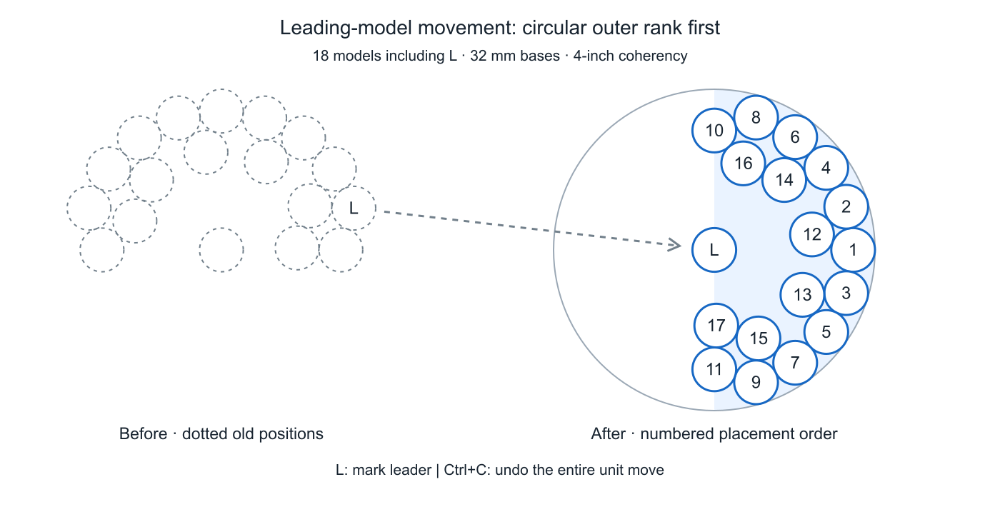

# Warhall developer TODO

Prioritized client/editor requests for the Starcraft mod. Supporting code and investigation notes are linked below.

1. [ ] **Leading-model movement.** Select a model and press **L** to mark it as the leader. Dragging that leader moves it and automatically places the whole unit in one drag: fill the exact forward circular arc first, alternating left/right, then fill inward gaps. Both players see the coherency circle (red when invalid), dotted previous unit positions, the old leader's movement arrow and numbered follower slots. After placement, non-leading models can be dragged individually without changing the leader, creating another circle or moving the rest of the unit. **Ctrl+Z** restores the whole pre-move unit as one undo transaction; later individual adjustments remain separate undo actions.

   **Alternative, after the above workflow:** normal click-and-drag on any model automatically makes **that clicked model** the leader and moves/places the whole unit. After placement, Shift-click-and-drag or Ctrl-click-and-drag fine-adjusts individual **non-leading** models without changing the leader or triggering another whole-unit move. No L keypress is required in this alternative.

   

   [Standalone C# planner](examples/leading-model/LeadingModelPlacement.cs) · [Unity integration and acceptance checks](examples/leading-model/README.md). Example: 18 models including the leader, 32 mm bases, 4-inch coherency. This is a proposed feature; the planner does not wire up game input, networking or undo.

2. [ ] **Platform collision.** Allow units to stand on imported ramps/platforms using mesh colliders on `ElevatedGround`, as they can on native Hill snow. Imported model collider generation is disabled; terrain selection height does not provide a walkable surface. Preserve elevated-ground collision when terrain is locked. [Client findings](docs/warhall-client-terrain-support.md).

3. [ ] **Token previews.** Resolve relative thumbnail paths to absolute URLs and provide a visible fallback on failure. Native tokens can use an embedded prefab `AssetUIConfig.UISprite`; custom GLB tokens need a reliable equivalent preview path. Keep custom artwork. [Investigation and native-token comparison](docs/token-menu-client-issue.md).

4. [ ] **32 mm marker measurement.** Measure from the circular base edge (16 mm radius), rather than a terrain corner or token center. Keep the decorative control ring separate from the measurement footprint.

5. [ ] **Hide terrain bases.** Add a per-terrain option to hide both base renderers while preserving necessary colliders. Do not hide unit bases. [Proposed client change](docs/warhall-client-terrain-support.md).

6. [ ] **Terrain locking/unlocking.** Loading deployments must not globally unlock map terrain. Preserve/restore the lock while spawning helpers, retain the manual lock toggle and test both map/deployment loading orders. [Client findings](docs/warhall-client-terrain-support.md).

7. [ ] **Cloud terrain menu.** Make `TerrainPanel` tolerate missing addressable prefabs for hosted GLB/OBJ models, create the button and then load a thumbnail with fallback. Native Hill snow works via `Frozen Tundra/Hill_FT`; the hosted ramp fails this lookup. [Comparison](docs/wds-editor-compatibility.md).

8. [ ] **Flip map.** Rotate terrain positions and orientations together by 180 degrees. Two flips must restore the original layout. [Client findings](docs/warhall-flip-limitations.md).

9. [ ] **Flip deployment.** Include mission markers and the red/blue border objects. Preserve their positions, colors and flip state when switching/reloading deployments. [Client findings](docs/warhall-flip-limitations.md).

10. [ ] **Lossless editor roundtrip.** Opening Tokens/Terrain must not silently edit data or drop unrecognized helpers. Preserve original IDs, dimensions, extra fields and references; emit changes only after an intentional edit. Keep manifest/version.json versions aligned on upload. [Roundtrip findings](docs/wds-editor-compatibility.md).

11. [ ] **Hide Change formation for Starcraft.** Only Cloud is configured; hiding the in-game Change formation control requires client support. The inspected client's UI.SetFormationButtonState always activates DropdownFormation for an owned unit; this bypasses InfoPanelButton's ShownButtons/HiddenButtons configuration. Honor a visibility setting for the in-game dropdown; do not offer other formations for Starcraft. Reform is now removed from ShownButtons and explicitly listed in HiddenButtons by the generator; Change formation remains a client-side limitation.

12. [ ] **Starcraft New Recruit import (paste and linked account).** The user confirms clipboard unit import works; pasting the same valid export into the separate textbox leaves Deploy buttons grey. Preserve the working generic unit parser and make the textbox use the same path. Fix validation/event/error handling and support the Starcraft text structure, not the 40k GW App format. Import units/model counts/upgrades, tactical and faction cards, deployment cards/choices and mission cards/choices. Make the linked NR account system selection game-aware rather than reading a fixed system key. The supplied list must resolve to eight units/28 models, six tactical cards, one faction card, two deployment choices and two mission choices. Repository-side planning/parser checks exist; full card/scenario import, exact live counts/upgrades and linked-account import remain unverified. [Reference parser, findings and acceptance criteria](docs/new-recruit-import.md).
