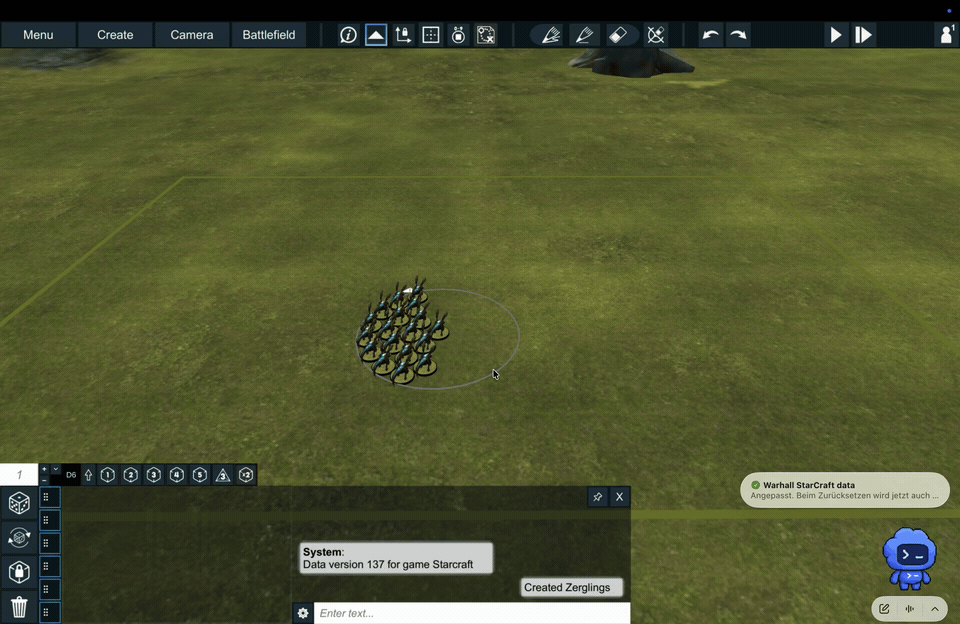

# Leading-model movement for Warhall

This is the source-level integration of the locally tested Unity prototype. Copy [LeadingMovement.cs](LeadingMovement.cs) into the game assembly. It uses the existing `GameItem`, `Soldier`, `Unit`, `Cloud`, `CornerMarker`, `UndoRedo`, Photon synchronization and radius drawing APIs. The developer integration uses source edits and requires no DLL patcher.

## Video demonstration



Use this recording as the visual reference for the intended interaction. The automatic squad reselection after releasing a model is a later addition documented below and included in the example code.

## Behavior

- A simple left-click highlights/selects the entire Cloud unit. The broken-heart button therefore adds wounds to the unit and uses the existing profile threshold to remove models. No changes to the damage calculation are required.
- Dragging a previously box-selected group preserves that selection and moves all selected models together. This also applies to multiple selected units. The leader teleport algorithm is suppressed during a group drag, even when the leader is selected.
- Left-dragging a model switches the highlight/selection to that model only after the native drag threshold is crossed. Only that model moves; no double-click is needed. On release after an individual drag, the whole unit is automatically highlighted/selected again for wound allocation, without an extra click. This also applies after right-button leader movement; the leader and its radius remain unchanged.
- Click a model and press **L** to select it as leader. Press **L** on the same model to disable leader mode.
- Alternatively, right-press an owned model, hold and drag, then release. This selects the leader, moves it, and distributes its followers in one gesture. Right-click on empty ground retains camera rotation.
- Only moving the leader redistributes the unit. Every model can still be dragged individually. The leader's circle persists until changed or disabled.
- Radius is **3 inches**, or **4 inches for Squadron**, detected from the active model/unit rules. Display and placement use the same value.
- The triangle reset restores the unit and every model's original world position, rotation, and the original leader.

## Hook locations

Add the following calls inside the existing methods, preserving their native bodies.

| Class and method | Insertion |
| --- | --- |
| `InputManager.MouseDown(GameItem gameItem)` | First lines `LeadingMovement.Click(gameItem); gameItem = LeadingMovement.SelectionTarget(gameItem);` |
| `InputManager.MouseEnter(GameItem gameItem)` | First line `LeadingMovement.Hover(gameItem);` |
| `InputManager.MouseExit(GameItem gameItem)` | First line `LeadingMovement.Leave(gameItem);` |
| `InputManager.Update()` | First line `LeadingMovement.Update();` and `LeadingMovement.AfterInput(this);` before **every return**, including GUI early exits |
| `InputManager.StartDrag()` | First line `LeadingMovement.PrepareSingleDrag(this);` |
| `Soldier.OnMouseDrag()` | First line `if (LeadingMovement.RequestDrag(this)) return;` |
| `Soldier.StartDrag(Vector3 position)` | First line `LeadingMovement.Begin(this);` |
| `Soldier.EndDrag()` | `LeadingMovement.Finish(this);` after the native body, on every normal exit |
| `CornerMarker.OnPhotonInstantiate(PhotonMessageInfo info)` | At the end, after `_myUnit` is resolved, `LeadingMovement.CaptureMarker(this);` |
| `CornerMarker.OnMouseDown()` | First line `if (LeadingMovement.RestoreMarker(this)) return;` |

`AfterInput` must run after the native input handling resets `CameraScrollInputAllowed`. It disables camera rotation during the prototype's right-button drag and restores squad selection after native drag completion. For source integration, a `try/finally` can cover all update exits.

```csharp
private void Update()
{
    LeadingMovement.Update();
    try
    {
        // Existing Update body, including early returns.
    }
    finally
    {
        LeadingMovement.AfterInput(this);
    }
}
```

## Click versus drag selection

The prototype overrides four reads of `_isSoldierSelectionCurrentMode`. Equivalent source edits are as follows. Scope them to the enabled movement feature in the production client.

- In `Soldier.OnMouseDown()` and `Soldier.OnMouseEnter()`, delegate to the parent only for `_parentUnit.IsSingleModel()`. Multi-model units use the existing base implementation immediately.
- In `Soldier.OnDoubleClick()`, retain `base.OnDoubleClick()` and remove the subsequent parent-unit selection triggered by `!_inputManager._isSoldierSelectionCurrentMode`.
- In `InputManager.DoubleClick()`, replace the current-mode toggle with `_isSoldierSelectionCurrentMode = true;`. Keep the remaining ownership, hover and selection handling.

Keep the original clicked Soldier before mapping the selection target to its Unit. The native click path then selects the squad, preserving broken-heart wound allocation. `RequestDrag` remembers the actual model; `PrepareSingleDrag` switches selection at native drag start, before the drag-item list is copied. Do not force individual selection on mouse-down. `SelectionTarget` returns an already selected Soldier unchanged when it belongs to a multi-selection; mapping it to the Unit here would collapse the selection before drag start.

The integration order is essential:

1. On mouse-down, call `Click(gameItem)` with the original Soldier, then map `gameItem` through `SelectionTarget` before assigning the native `_mouseDown`. This keeps the exact model for L while letting native selection target the Unit.
2. In `Soldier.OnMouseDrag`, let `RequestDrag(this)` intercept supported model drags before the parent-unit forwarding branch.
3. At the very start of `InputManager.StartDrag`, call `PrepareSingleDrag(this)` **before** copying `_mouseDrag` into `_dragItem`. If the touched model or its parent belongs to a selection of multiple items, it keeps that selection and the native drag list. Otherwise it deselects the Unit, selects the remembered Soldier and rebuilds the drag list.
4. After an individual drag, at every `Soldier.EndDrag` exit, `Finish` queues the parent Unit for selection, including when a follower was moved or no redistribution occurred. `AfterInput` consumes that request after native input processing has finished. Do not change selection inside the native drag-item iteration: finish movement, recentering, synchronization and Undo recording first. Restore the leader radius after selecting the Unit.
5. Keep native wound handling unchanged. Right-button leader movement uses its own individual selection path; ordinary squad clicks must not clear the leader or its radius.

Use **Cloud/group formation with SoldierMagnet disabled**. The helper checks this before enabling a leader.

## Placement and reset semantics

`Finish` plans all follower positions before moving anything. On a 1.5 mm grid, it places larger bases first, prioritizes forward projection along the leader's movement, then separation. Entire bases fit inside the leader's range with a 0.2 mm minimum gap. Round leaders measure range from their base edge. Oval/rectangular bases use the larger axis as a circular approximation. If packing fails, followers stay put and the manual leader move remains. Terrain, other units and battlefield boundaries are currently ignored.

The triangle snapshot is captured when the marker is created. If no leader exists then, the first subsequent leader movement records it. Later leader changes do not replace that snapshot. Reset restores model transforms using `SyncSoldierLocalTransform` and records move/rotate actions in an Undo group. It does not resurrect removed models. Snapshots are local session state, not saved-game data.

## Checks before shipping

Verify a plain click highlights the squad and broken-heart wounds remove models at the profile threshold; then verify dragging a follower moves only that follower and release immediately reselects the squad. Check wounds immediately after both left-drag and right-drag, without another click. Verify L on/off, right-drag versus ground-camera drag, individual follower adjustment, 3/4-inch rules, reset after a leader change, and undo/redo in a two-client room. Escape/focus loss cancels right-drag. The local user tested the movement prototype, but full multiplayer, saved-game persistence and collision validation remain open. Integrate the shortcut through Warhall's input bindings, gate the feature by game system, and store state per game instead of the prototype's static state before general release.

The local app now includes automatic squad reselection after individual drags and preserves multi-selection after group drags. Selection-path tests passed; an in-game group drag and two-client test remain required.

The production installer patches the existing app directly, without prompts. The normal Warhall app/launcher remains the entry point. A hash-checked original DLL backup supports restore, and WarhallCommunityPatch.log is written beside the patcher. See [the installer guide](../../tools/client-patch/README.md).

## Token radius regression (patch 1.0.3)

At the start of `GameItem.RedrawShapeDrawer(Material materialOverride = null)`, add `if (!LeadingMovement.ShouldRedraw(this)) return;`. Hidden token radii must stay hidden during movement/redraw. Explicitly visible token radii continue to redraw; soldier leader circles and group selection are unchanged. This guard is included in patch 1.0.3; the token-drag reproduction still needs a client playtest.

## Single-model right drag

Resolve hovering over a one-model Unit to its sole active Soldier. Right-drag uses the existing movement, cancellation and Undo path for that model and suppresses camera rotation for the gesture. It does not set a leader or draw a new leader ring.
