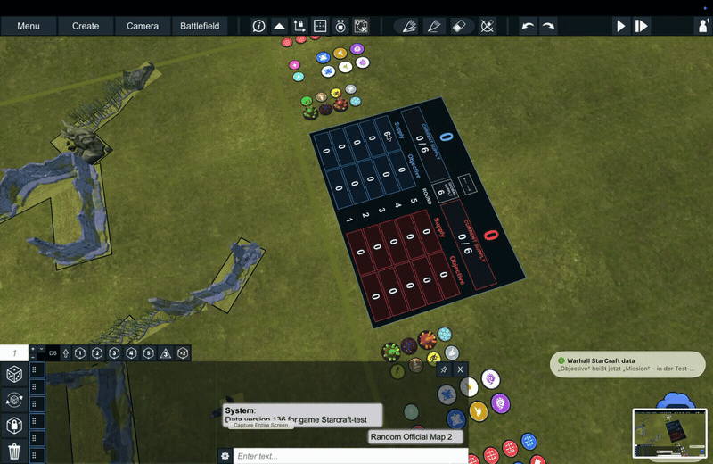

# StarCraft map scoreboard

An interactive scoreboard built entirely from Unity UI at runtime. It uses a world-space Canvas, RectTransforms, Images and Text with Unity's built-in LegacyRuntime.ttf font. No scoreboard image, model, texture, skin registration or downloaded asset is required.

Copy [StarcraftScoreboard.cs](StarcraftScoreboard.cs) and [StarcraftTray.cs](StarcraftTray.cs) into the game assembly. Dependencies: existing Warhall TerrainItem, Token, Card and InputManager classes; UnityEngine.CoreModule, UIModule, UI, TextRenderingModule, PhysicsModule and InputLegacyModule. This is source-level integration; the local prototype used Mono.Cecil to inject the same calls.

## Demonstration

## Behavior

- Only the StarCraft terrain ID `Starcraft - Terrain - Scoreboard - score1` activates the board. Other terrain IDs keep their native behavior.
- The board sits outside the right map edge, between the two token trays, facing the battlefield. It measures 40 × 28.4 cm. Round 1 is at the bottom; round 5 at the top.
- Each side has Supply and Mission points for every round. Left-click increases a value; right-click decreases it, with a minimum of zero.
- The large totals automatically sum both point columns across all five rounds.
- Current Supply is independently adjustable per side, initially 0 / 6. Global Supply is the shared denominator, initially 6. Changing the denominator does not change current values.
- The small **← →** button between the totals swaps blue/red styling, including headings, outlines and column backgrounds. Scores and supply values stay in their current positions. Left-click again to restore the original colors.
- There is no title, player-name banner or mouse-instruction footer.

## Integration hooks

Preserve native method bodies and apply these hooks only when this feature is enabled.

| Location | Insertion |
| --- | --- |
| `TerrainItem.RPCConfigureTerrain(string wdsId, string owner, int forceScenarioIndex)` | First line: `if (StarcraftScoreboard.Configure(this, wdsId, owner)) return;` |
| `Token.RPCConfigureToken(string tokenId, string owner, int idSkin)` | First line: `StarcraftTray.Track(this, tokenId);` |
| `InputManager.Update()` | Before native input processing and before the leading-movement hook: `if (StarcraftScoreboard.Tick()) return;` |

The terrain hook must run **before skin lookup**. Otherwise a missing catalogue assignment loads an unrelated fallback model or throws before the board can be created. Configure stores the terrain identity/owner and skips native skin loading for this ID.

Tick discovers the scoreboard terrain, creates its Canvas, hides its original renderers/colliders, and follows its final position after map placement. It raycasts the active camera onto the UI plane, converts the hit to local pixel coordinates, and dispatches clicks to numeric cells or the color-swap button. Consumed clicks return before native model dragging or camera rotation. No GraphicRaycaster or EventSystem button listener is needed in this prototype.

World orientation matters: with Warhall's map coordinates, the right tray is on **negative world X**. The Canvas uses Euler rotation (90, -90, 0). The current placement infers the battlefield edge from the old left scoreboard's anchor; production should use the actual battlefield bounds instead.

## Token trays

StarcraftTray tracks **WDS token IDs**, not display names. Its 56 regular slots were generated from `src/tokens/tray.mjs` and resolved through `Starcraft-test/tokens.json`. Refresh those definitions when the token package changes.

The helper arranges the two trays outside the right map edge and leaves a gap around the scoreboard. It only considers tracked StarCraft tokens in the staging area, excluding cards and the battlefield center. The five regular activation markers plus the alternative-color marker per row remain intact.

An extra staging token is locally disabled only if all expected slots of the same token ID on the same side already have visible assigned tokens. Unknown or incompletely assigned groups remain visible. Using display names here previously matched zero tokens and hid everything; retain the ID check and complete-group guard.

The scoreboard itself needs no assets. The surrounding game tokens still need their normal model/texture assets. The separate local fallback for missing server skin assignments is not part of this UI implementation.

## State and remaining integration work

The example holds counters, colors and tray assignments locally in memory. Values are not synchronized over Photon, serialized into saved games, or included in Undo/Redo. Recreating the scoreboard starts a new set of counters.

Before production integration, store state per board, add validated shared updates and save/load support, replace the polling/input hook with the game's normal UI lifecycle, and derive placement from map bounds. The staging cleanup is a local prototype workaround; use one canonical preset source in production rather than allowing map and preset creation to duplicate tokens.

Verify: five-round totals; left/right clicks and zero clamp; shared denominator; color swap preserving all numeric values; map load after placement; 54×36 and 36×36 boards; one tray per player without overlap; no activation in other game systems; cleanup when leaving the room. Compilation and local DLL injection were checked. The color-swap interaction still needs an in-game visual test.
